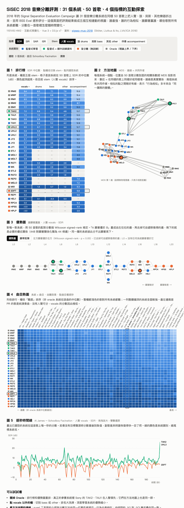

# 1151VIS HW2：SiSEC 2018 音樂分離評測結果的互動探索

- 主題：2018 年 Signal Separation Evaluation Campaign（SiSEC）的音樂分離任務，讓 31 個系統在同樣 50 首歌上把人聲、鼓、貝斯、其他樂器拆出來，並以 BSS Eval 逐秒評分。本專案把這份「系統 × 曲目 × stem × 指標」的評測結果做成五個互相連動的互動視圖：誰最強、誰的行為相似、誰顯著贏誰、哪些歌對所有系統都難、分數在一首歌裡怎麼隨時間變化。
- 線上展示：<https://liying-c.github.io/1151VIS-HW2-415085023-LiYingCHEN/>

---

## 1. 專案截圖



> 由上而下：控制列（指標、stem、系統類別開關）；圖 1 排行榜熱圖（系統 × stem）；圖 2 方法地圖（MDS 投影加共同作者連線）；圖 3 優勢圖（Wilcoxon 檢定後的 Hasse diagram）；圖 4 系統 × 曲目熱圖（由難到易）；圖 5 選取曲目後的逐秒時間線。畫面中選取了 TAK2、UHL3、2DFT 三個系統與一首曲目，所有視圖同步高亮。

---

## 2. GitHub 連結

- Repository：<https://github.com/liying-c/1151VIS-HW2-415085023-LiYingCHEN>
- 線上展示（GitHub Pages）：<https://liying-c.github.io/1151VIS-HW2-415085023-LiYingCHEN/>
- 直接開到截圖的狀態：<https://liying-c.github.io/1151VIS-HW2-415085023-LiYingCHEN/?sel=TAK2,UHL3,2DFT&t=al-james-schoolboy-facination>

---

## 3. YouTube 連結

- 互動展示影片：<https://www.youtube.com/watch?v=jRY7O2JwRWo>

---

## 4. 製作流程與相關操作說明

### 4.1 選題與資料

HW1 用合成訊號呈現「時域 vs 頻域」的觀念，屬於科學視覺化。HW2 改做資訊視覺化：資料是一筆一筆有屬性的記錄，重點在比較、分群、找關聯，而不是畫訊號。

選用 **SiSEC 2018 MUS** 的公開評測結果（<https://github.com/sigsep/sigsep-mus-2018>）：

- 31 個分離系統，其中 6 個是 oracle（用真實答案算出的理想遮罩，代表方法的上界；MIX 是直接把混音當估計，代表下界），其餘 25 個是真正的參賽方法，可再分成盲分離（不需訓練）、監督式學習、監督式加額外訓練資料三類。
- 50 首 MUSDB18 測試曲，每首 4 個 stem（vocals、drums、bass、other）加 accompaniment。
- 每個系統對每首歌的每個 stem，以 museval 每秒計算 SDR、SIR、SAR、ISR 四個指標，約 200 秒。

原始資料是 1550 個 JSON（31 系統 × 50 首歌）共 343 MB，由 `prepare_data.py` 彙整成四種 CSV（見 4.5）。這份資料與我個人的音訊分離研究直接相關，但完全是他人的公開評測結果，不涉及任何研究用音檔。

### 4.2 指標的意義

BSS Eval 把系統估出的 stem $\hat{s}$ 拆成四個互相正交的分量：

$$
\hat{s} = s_{\text{target}} + e_{\text{spat}} + e_{\text{interf}} + e_{\text{artif}}
$$

分別是真正屬於目標的部分、空間（立體聲像）失真、其他來源漏進來的干擾、以及剩下無法解釋的人工瑕疵。四個指標都是能量比（dB），越高越好：

| 指標 | 定義 | 回答的問題 |
|---|---|---|
| SDR | $10\log_{10}\dfrac{\lVert s_{\text{target}}\rVert^2}{\lVert e_{\text{spat}}+e_{\text{interf}}+e_{\text{artif}}\rVert^2}$ | 整體好不好 |
| SIR | $10\log_{10}\dfrac{\lVert s_{\text{target}}\rVert^2}{\lVert e_{\text{interf}}\rVert^2}$ | 分得乾不乾淨 |
| SAR | $10\log_{10}\dfrac{\lVert s_{\text{target}}+e_{\text{spat}}+e_{\text{interf}}\rVert^2}{\lVert e_{\text{artif}}\rVert^2}$ | 聽起來自不自然 |
| ISR | $10\log_{10}\dfrac{\lVert s_{\text{target}}\rVert^2}{\lVert e_{\text{spat}}\rVert^2}$ | 立體聲像保留得好不好 |

SIR 與 SAR 常互相拉扯：遮罩切得越狠，干擾越少但瑕疵越多。在頁面上把指標從 SIR 切到 SAR，就能看到排名位置互換的系統。

### 4.3 分析方法

**彙整。** 與 SiSEC 官方一致：每個指標先對一首歌的所有秒數取中位數，系統排名再對 50 首歌取中位數。取中位數而非平均，是因為目標靜音的秒數（例如前奏沒人聲）分數為 NaN 或 $-\infty$，會把平均拖垮。

**相似度與 MDS（圖 2）。** 把系統 $i$ 在 50 首歌上的分數視為向量 $\mathbf{p}_i \in \mathbb{R}^{50}$，兩系統的 Pearson 相關 $r_{ij}$ 轉成距離

$$
d_{ij} = \sqrt{2\,(1 - r_{ij})}
$$

這正是把 $\mathbf{p}_i$、$\mathbf{p}_j$ 各自標準化後的歐氏距離。古典 MDS 對距離矩陣 $D$ 做雙中心化 $B = -\tfrac{1}{2} J D^{(2)} J$（$J = I - \tfrac{1}{n}\mathbf{1}\mathbf{1}^\top$），取 $B$ 最大的兩個特徵對 $(\lambda_k, \mathbf{v}_k)$，座標為 $\sqrt{\lambda_k}\,\mathbf{v}_k$。程式用冪迭代加 deflation 求前兩個特徵向量，不需要線性代數套件。投影座標沒有物理意義，只表示相對距離；圖上再用一個短的力模擬把重疊的點推開（JY1 與 JY2 的相關係數為 1.000，原本完全重疊）。

**共同作者的邊（圖 2）。** 從各系統 `description.md` 的署名欄位抽出作者集合，兩系統有交集就連一條邊。這是資料裡唯一真實存在的關係，不是推導出來的；它和 MDS 的距離互相驗證：相似的點之間剛好有邊，說明「行為相似」多半來自「同一團隊的變體」。

**顯著優於與 Hasse diagram（圖 3）。** 對每一對系統，用 50 首歌的配對分數做 Wilcoxon signed-rank 檢定：取差值 $d_k$，依 $|d_k|$ 排名（同值取平均名次），正差值的名次和 $W^+$ 在虛無假設下近似常態

$$
\mu = \frac{n(n+1)}{4}, \qquad \sigma^2 = \frac{n(n+1)(2n+1)}{24} - \frac{\sum_t (t^3 - t)}{48}
$$

（$t$ 為各組同值的個數），$z = (W^+ - \mu)/\sigma$，雙尾 $p < 0.05$ 且勝率 $> 0.5$ 才視為「A 顯著優於 B」。這些邊構成一個有向無環圖；再做**遞移化簡**（若 A→C 可由 A→B→C 推得，就去掉 A→C），只留必要的邊，並以**最長路徑**分層：第 0 層是沒有任何系統顯著優於它的系統。人聲 SDR 下，465 對比較裡有 448 對顯著，化簡後只剩 44 條邊；層數有 21 層，表示優劣關係接近全序。勝率矩陣模式則把每一對的「A 在幾成的歌上贏 B」直接畫出來。

**曲目難度與重排熱圖（圖 4）。** 一首歌的難度定義為非 oracle 系統在該曲分數的中位數。熱圖的列依系統排行、欄依難度排序（seriation），「所有系統都難的歌」就浮現成整欄淺色。人聲 SDR 最難的兩首 PR 的歌是純演奏曲，沒有人聲可分，分母趨近零，分數掉到 $-20$ 與 $-42$ dB。

`tests/check_stats.mjs` 用已知答案驗證這些函式：中位數、Pearson、Wilcoxon（明顯優於 → $p < 10^{-3}$；對稱差異 → $p = 1$）、MDS 能還原平面上四點的距離、遞移化簡與分層。

### 4.4 視覺化與互動設計

**編碼原則**（延續 HW1 老師的回饋：同樣的東西只用一種畫法）

- 顏色跟著**系統類別**走，不跟著個別系統走：31 個系統不可能有 31 種可分辨的顏色。三個類別色（藍、綠、橘）用 dataviz 驗證器檢查過色盲可分辨性與對比，oracle 用灰色表示它是參考線而非參賽者。個別系統靠文字標籤辨識，選取的系統在所有視圖用相同的黑框高亮。
- 分數一律用同一組單色漸層（藍，淺 → 深 = 低 → 高），排行榜與曲目熱圖共用同一個色階，深色模式改用同色階反向，讓「高」是亮的。
- 勝率矩陣用發散色（紅 — 灰 — 藍），灰色落在 0.5 代表五五波。

**視圖與互動**

| 視圖 | 形式 | 互動 |
|---|---|---|
| 控制列 | 指標、stem、類別開關 | 任何改動所有視圖同步重算；類別開關同時是圖例 |
| 圖 1 排行榜 | 系統 × stem 熱圖 | 點欄名切換全域 stem 並排序；點列選取（可多選）；hover 顯示數值 |
| 圖 2 方法地圖 | MDS 散佈圖 + 作者邊 | 點選系統；hover 顯示作者與機構；hover 邊顯示共同作者 |
| 圖 3 優勢圖 | Hasse diagram / 勝率矩陣 | 切換模式；hover 節點亮起它的所有邊並列出直接優於／劣於誰；矩陣 hover 顯示勝場數與 p 值 |
| 圖 4 曲目熱圖 | 系統 × 曲目重排熱圖 | 點曲目載入逐秒資料；hover 顯示分數；選取曲目的欄位加框 |
| 圖 5 時間線 | 多系統折線 | 拖曳放大時間範圍、雙擊還原；十字線顯示各系統當秒分數；線尾直接標名 |
| 網址 | `?m=SIR&s=drums&c=supervised,blind&sel=TAK2,UHL3&t=track-id` | 重新整理或分享連結都能回到同一狀態 |

資料表（頁尾的 details）列出 31 個系統的作者、機構、程式連結與目前指標的中位數，讓數值不靠顏色也能閱讀。

### 4.5 程式架構

分工原則與 HW1 相同：**Vue 管狀態與資料流，D3 管比例尺、座標軸與 SVG 繪圖。**

| 檔案 | 內容 |
|---|---|
| `prepare_data.py` | 讀 1550 個 museval JSON 與 31 個 `description.md`，輸出 `public/data/`：`systems.csv`（類別、是否 blind、額外資料、作者、機構、程式）、`tracks.csv`、`scores_track.csv`（逐秒中位數，6050 列）、`frames/<track>.csv`（逐秒分數，選到才載入） |
| `src/stats.js` | 中位數、Pearson、勝率、Wilcoxon signed-rank、常態 CDF、古典 MDS（冪迭代）、遞移化簡、最長路徑分層 |
| `src/data.js` | `d3.csv` 載入與索引、作者字串正規化 |
| `src/App.vue` | 狀態（指標、stem、類別、選取系統、選取曲目）與一連串 `computed`：剖面 → 中位數 → 排行 → 排行榜矩陣、MDS 座標、作者邊、優勢圖、曲目難度；網址同步；頁面版面與說明 |
| `src/components/ControlBar.vue` | 控制列（`defineModel` 雙向綁定） |
| `src/components/Leaderboard.vue` | 圖 1 |
| `src/components/MethodMap.vue` | 圖 2，MDS 座標加 `d3.forceCollide` 防重疊 |
| `src/components/DominanceGraph.vue` | 圖 3，橫向分層的 Hasse diagram 與勝率矩陣兩種模式 |
| `src/components/TrackHeatmap.vue` | 圖 4 |
| `src/components/Timeline.vue` | 圖 5，`d3.brushX` 放大、十字線 tooltip |
| `src/tooltip.js` | 全站共用的 tooltip 狀態 |
| `src/series.js` | 類別顏色與名稱、指標與 stem 清單 |
| `src/style.css` | 色票（含深色模式）、控制列、SVG 元素樣式 |
| `tests/check_stats.mjs` | 統計函式驗證 |

### 4.6 執行與驗證

```bash
cd 1151VIS-HW2-415085023-LiYingCHEN
npm install
npm run dev        # 開發伺服器，預設 http://localhost:5173/
npm run check      # 驗證 stats.js
npm run build      # 打包到 dist/，npm run preview 預覽
```

重新產生資料（需先 clone 原始結果 repo，約 343 MB）：

```bash
git clone --depth 1 https://github.com/sigsep/sigsep-mus-2018.git ../sisec18-raw/sigsep-mus-2018
npm run data       # = python3 -I prepare_data.py ../sisec18-raw/sigsep-mus-2018
```

`prepare_data.py` 執行完會印出人聲 SDR 的前十名，可與 SiSEC 2018 論文的排名對照（IRM2 > MWF > IRM1 > IBM2 > IBM1 > TAK2 > TAU1 > TAK3 > TAK1 > UHL3）。

### 4.7 建立 GitHub repository 與上傳

**(1) 建立 repository，Visibility 設為 Public**

```bash
gh repo create 1151VIS-HW2-415085023-LiYingCHEN --public --source=. --remote=origin
```

若用網頁操作：GitHub 右上角 **+ → New repository** → Repository name 填 `1151VIS-HW2-415085023-LiYingCHEN` → Visibility 選 **Public** → Create repository。

**(2) .gitignore**

GitHub 建立 repo 時的 .gitignore 範本清單沒有「HTML」這個選項，因此沿用 HW1 自行撰寫的 `.gitignore`，排除 `node_modules/`、`dist/`、`.DS_Store`、編輯器設定等。原始的 343 MB JSON 不進 repo，只進彙整後的 CSV（約 50 MB，其中逐秒檔案 49 MB）。

**(3) 上傳專案**

```bash
git init
git add .
git commit -m "HW2: interactive exploration of SiSEC 2018 music separation results with Vue 3 + D3.js"
git push -u origin master
```

**(4) 部署到 GitHub Pages**

`.github/workflows/deploy.yml` 在每次推到 `master` 時自動 `npm ci` → `npm run build`，再把 `dist/` 發佈到 GitHub Pages。Pages 來源設定為 GitHub Actions：

```bash
gh api -X POST repos/liying-c/1151VIS-HW2-415085023-LiYingCHEN/pages -f build_type=workflow
```

### 4.8 螢幕錄影、擷取關鍵畫面與上傳 YouTube

**影片內容（1 分 30 秒）**：<https://www.youtube.com/watch?v=jRY7O2JwRWo>

1. 從頁面頂端捲到底再回來，瀏覽五個視圖。
2. 圖 1：點 `drums`、`bass` 欄名切換 stem，排名與其他視圖同步更新；點回 `vocals`。
3. 控制列：指標切到 SIR、SAR，再切回 SDR。
4. 控制列：關掉「Oracle」類別，排行榜、方法地圖與優勢圖重排，只剩真正的參賽系統。
5. 圖 1：選取 TAK2、UHL1、REP2（三種類別各一個），所有視圖以黑框同步高亮。
6. 圖 2：滑過幾個點與一條共同作者的連線，顯示提示框。
7. 圖 3：切到勝率矩陣，再切回優勢圖。
8. 圖 4：點最左邊（最難）的歌，圖 5 出現逐秒時間線；再點最右邊（最易）的歌比較。
9. 圖 5：滑過看各系統當秒分數，拖曳放大一段時間，雙擊還原。
10. 按「清除」回到初始狀態。

**錄製方式**

以 Playwright 驅動 Microsoft Edge 開啟 GitHub Pages 上的線上版，依上述步驟自動操作並錄成 1280 × 800 的 WebM 影片。錄影不含系統游標，畫面上的橘色圓點是為了標示滑鼠位置而加上的。影片沒有旁白。

**擷取關鍵畫面**

`screenshot.png` 是開啟帶參數的網址（見第 2 節「直接開到截圖的狀態」）後擷取的整頁畫面，放在 repo 根目錄。

**上傳 YouTube**

1. 開啟 <https://studio.youtube.com> → 右上角 **建立 → 上傳影片**，選取錄好的影片檔。
2. 瀏覽權限選 **不公開**（有連結的人可觀看）或 **公開** → 儲存。
3. 複製影片連結，填入本文件第 3 節，並 `git commit` / `git push` 同步到 repo。

### 4.9 資料來源與授權

- 評測結果：sigsep/sigsep-mus-2018 <https://github.com/sigsep/sigsep-mus-2018>。各系統以 pull request 提交的 museval 分數與 `description.md`。該 repo 未附授權條款；本專案僅將分數（量測事實）彙整後用於教學與研究，不複製各團隊撰寫的方法說明，作者與機構欄位取自各系統的署名，用於標示來源。
- 評測活動論文：F.-R. Stöter, A. Liutkus, N. Ito, "The 2018 Signal Separation Evaluation Campaign," *LVA/ICA 2018*. <https://arxiv.org/abs/1804.06267>
- 指標定義：E. Vincent, R. Gribonval, C. Févotte, "Performance measurement in blind audio source separation," *IEEE TASLP*, 2006；museval（BSS Eval v4）<https://github.com/sigsep/sigsep-mus-eval>
- 曲目：MUSDB18 <https://sigsep.github.io/datasets/musdb.html>，本專案只用曲名，不包含音訊。
- 本專案程式碼以 MIT 授權（見 `LICENSE`）；`public/data/` 為衍生資料，依原始來源條款使用（見 `public/data/README.md`）。

### 4.10 檔案結構

```
.
├── index.html                 # Vite 進入點，掛載 #app
├── package.json               # 相依：vue、d3、vite、@vitejs/plugin-vue；scripts: dev / build / preview / check / data
├── vite.config.js             # base: './'，打包後用相對路徑
├── LICENSE                    # MIT（程式碼）；資料另見 public/data/README.md
├── .github/workflows/deploy.yml   # 自動 build + 部署到 GitHub Pages
├── prepare_data.py            # 原始 JSON → public/data/*.csv
├── public/data/
│   ├── README.md              # 資料來源與引用
│   ├── systems.csv            # 31 個系統的屬性
│   ├── tracks.csv             # 50 首曲目
│   ├── scores_track.csv       # 曲目層級分數（逐秒中位數）
│   └── frames/<track>.csv     # 逐秒分數，按需載入
├── tests/check_stats.mjs      # 統計函式驗證
├── src/
│   ├── main.js
│   ├── App.vue                # 狀態、computed 資料流、版面
│   ├── data.js                # 載入與索引
│   ├── stats.js               # 統計與圖論
│   ├── series.js              # 類別顏色、指標與 stem 清單
│   ├── tooltip.js             # 共用 tooltip
│   ├── style.css
│   └── components/
│       ├── ControlBar.vue
│       ├── Leaderboard.vue    # 圖 1
│       ├── MethodMap.vue      # 圖 2
│       ├── DominanceGraph.vue # 圖 3
│       ├── TrackHeatmap.vue   # 圖 4
│       └── Timeline.vue       # 圖 5
├── screenshot.png
├── .gitignore
└── README.md
```
